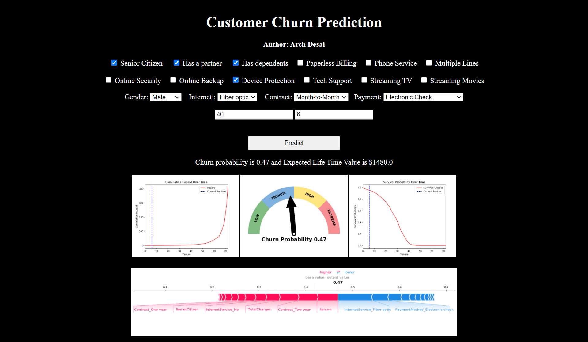
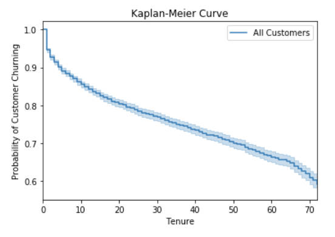
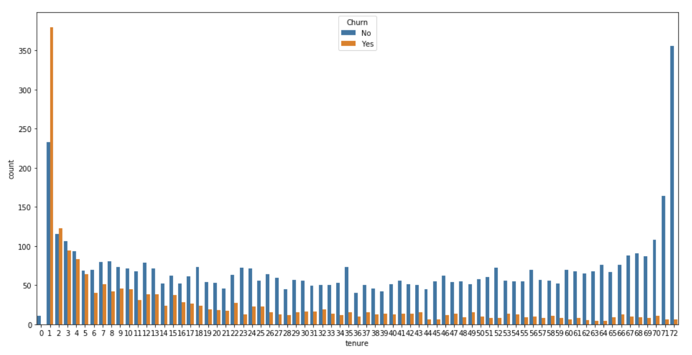
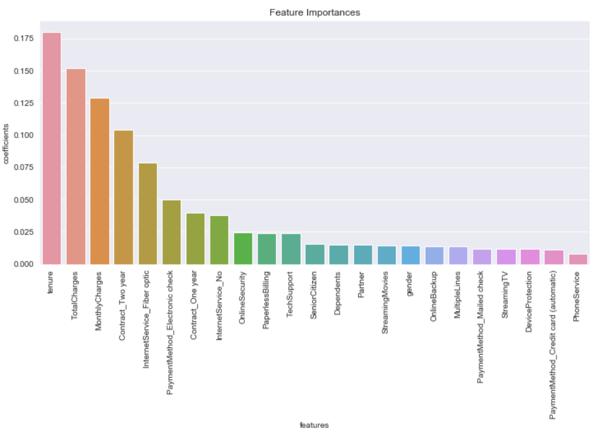

# Customer Survival Analysis and Churn Prediction

An interactive Flask dashboard for estimating customer churn risk, expected customer lifetime value, and survival over time. The project combines a Random Forest churn classifier with survival-analysis concepts and an explainable customer profile workflow.

## Live application

This repository contains the runnable Flask application. To start it locally, follow the setup instructions below.

## What the app does

Create a customer profile using:

- Gender and senior-citizen status
- Partner and dependent status
- Phone and internet services
- Optional support, security, backup, protection, and streaming services
- Contract and payment method
- Monthly charges and customer tenure

The dashboard then provides:

- Churn probability
- Expected lifetime value estimate
- Churn-risk gauge
- Cumulative hazard chart
- Survival-probability chart
- Top model feature-importance explanation

The interface is responsive and includes interactive sliders and service-aware controls. Internet add-ons are disabled when the customer has no internet service, and multiple lines is disabled when phone service is not selected.

## Dashboard preview



Use the dashboard to enter a customer profile and review the resulting risk gauge, survival outlook, lifetime value estimate, and model explanation.

## Analysis visualizations

### Customer survival curve

<p align="center">
  
</p>

### Churn and tenure relationship

<p align="center">
  
</p>

### Model feature importance

<p align="center">
  
</p>

The complete collection of segment comparisons and model-analysis plots is available in the [`Images/`](Images/) directory.

## Quick start

### Requirements

- Python 3.11
- pip

### Install dependencies

From the project directory:

```powershell
python -m pip install -r requirements.txt
```

### Run locally

```powershell
python app.py
```

Open the application at:

```text
http://127.0.0.1:5000
```

### Run with Gunicorn

The included `Procfile` uses:

```text
web: gunicorn app:app
```

Gunicorn is primarily intended for Linux-based deployment environments. On Windows, use `python app.py` for local development.

## Project structure

```text
.
├── Images/                             Analysis and presentation images
├── static/images/                      App chart assets
├── templates/index.html                Interactive dashboard UI
├── app.py                              Flask application and prediction route
├── model.pkl                           Random Forest churn model
├── survivemodel.pkl                    Cox survival-analysis model
├── Churn Prediction Model.ipynb        Churn model development
├── Customers Survival Analysis.ipynb   Survival-analysis development
├── Exploratory Data Analysis.ipynb     Exploratory data analysis
├── requirements.txt                    Python dependencies
├── Procfile                            Deployment command
├── LICENSE.md                          MIT license
└── README.md                           Project documentation
```

## Prediction flow

The `POST /predict` route:

1. Converts the submitted customer profile into the feature layout expected by the saved model.
2. Calculates churn probability with the Random Forest model.
3. Builds a feature-importance explanation chart.
4. Generates hazard and survival charts.
5. Estimates lifetime value from the customer's monthly charges and viable survival period.
6. Renders the results in the dashboard.

The home page is available at `GET /`.

## Model compatibility

The model artifacts were originally created with older versions of the Python machine-learning stack. The current application includes compatibility handling for the saved survival model and uses the dependency versions in `requirements.txt` for a modern Python 3.11 environment.

If an old survival-model artifact can be loaded but cannot execute with the installed version of `lifelines`, the app uses a probability-calibrated survival approximation for the charts and lifetime estimate instead of failing the request. This keeps the dashboard usable while preserving the classifier's churn prediction.

The model files are binary artifacts and should be replaced only with models trained using the same feature order documented in `app.py`.

## Analysis notebooks

The notebooks document the original analysis workflow:

- Exploratory data analysis and customer-segment comparisons
- Kaplan-Meier survival curves
- Log-rank tests
- Cox proportional-hazards modeling
- Random Forest churn prediction
- Model interpretation and feature importance

## Key analysis themes

The analysis explores how churn changes with:

- Tenure and contract length
- Monthly charges and total charges
- Internet-service type
- Payment method
- Optional support and protection services
- Customer household characteristics

The findings are intended to support retention prioritization, not to replace business judgment or customer communication.

## License

This project is available under the [MIT License](LICENSE.md).
